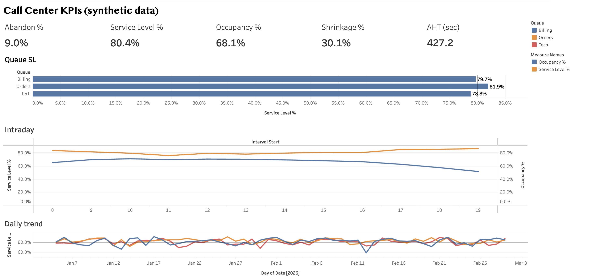

# Call Center KPI Analytics (AHT, Service Level, Abandonment, Occupancy, Shrinkage)

Interval-level contact-center reporting: the standard workforce-management (WFM) KPIs in SQL + Python, output as Tableau-ready CSVs.

> **Tableau Public dashboard:** [Call Center KPI Dashboard](https://public.tableau.com/app/profile/naveen.k7476/viz/CallCenterKPIDashboard_17913996371520/Dashboard1) (KPI tiles, queue service level vs the 80/20 target, intraday service level vs occupancy, daily trend). Build steps: [docs/tableau_guide.md](docs/tableau_guide.md)
>
> **Looker Studio (Data Studio) dashboard:** [Call Center KPI Dashboard](https://datastudio.google.com/reporting/92f4edea-1216-47ae-82be-718f07dbc80b) (same KPIs rebuilt from `data/intervals.csv` with calculated fields, service level by 30-minute interval showing the 11:00 dip, queue service level vs the 80% target, daily trend, queue filter).

[](https://public.tableau.com/app/profile/naveen.k7476/viz/CallCenterKPIDashboard_17913996371520/Dashboard1)
*Built from `data/intervals.csv`. All numbers are from synthetic data.*

## ⚠ Data is synthetic
`data/intervals.csv` is **generated** by [`src/call_center_sim.py`](src/call_center_sim.py): 8 weeks × 3 queues (Billing, Tech, Orders) × 30-min intervals, 08:00–20:00. Staffing is sized with the **Erlang C** formula to an 80/20 target and then disturbed by forecast error and varying shrinkage. Volumes, AHTs and shrinkage are my assumptions, so the numbers show the method, not a real operation. The pipeline takes any real dataset with the same columns (see the header of `data/intervals.csv`).

## KPI definitions ([`sql/kpis.sql`](sql/kpis.sql))
| KPI | Formula |
|---|---|
| AHT | (talk + hold + after-call work) / answered |
| Service level | answered within 20 s / offered (target 80/20) |
| Abandonment | abandoned / offered |
| ASA | total wait of answered calls / answered |
| Occupancy | handle time / logged-in time |
| Shrinkage | 1 − logged-in time / scheduled time |
| Adherence | in-adherence time / scheduled time |

## Results on the synthetic data
| Queue | AHT | Service level | Abandon | Occupancy | Shrinkage |
|---|---|---|---|---|---|
| Billing | 421 s | 79.7% | 9.4% | 68% | 30% |
| Orders | 299 s | 81.9% | 8.3% | 67% | 30% |
| Tech | 639 s | 78.8% | 9.7% | 69% | 30% |

Service level dips to ~76% at 11:00–12:00 while staffing is flat, and it overshoots (86%+) in the evening with occupancy near 50%. That points to shifting schedules, not adding headcount.

## Run
```bash
pip install pandas numpy
python src/call_center_sim.py   # generate (skip if using real data)
python src/build_kpis.py        # -> data/outputs/kpi_by_{interval,day,queue}.csv
sqlite3 :memory: ".mode csv" ".import data/intervals.csv intervals" ".read sql/kpis.sql"
```
Then connect Tableau to `data/outputs/*.csv`: KPI tiles by queue, an intraday service level vs occupancy line, and a daily trend with the 80% target line.

## Next
Swap in a real call center dataset with the same columns, and add an Erlang C staffing-requirement calculator.
