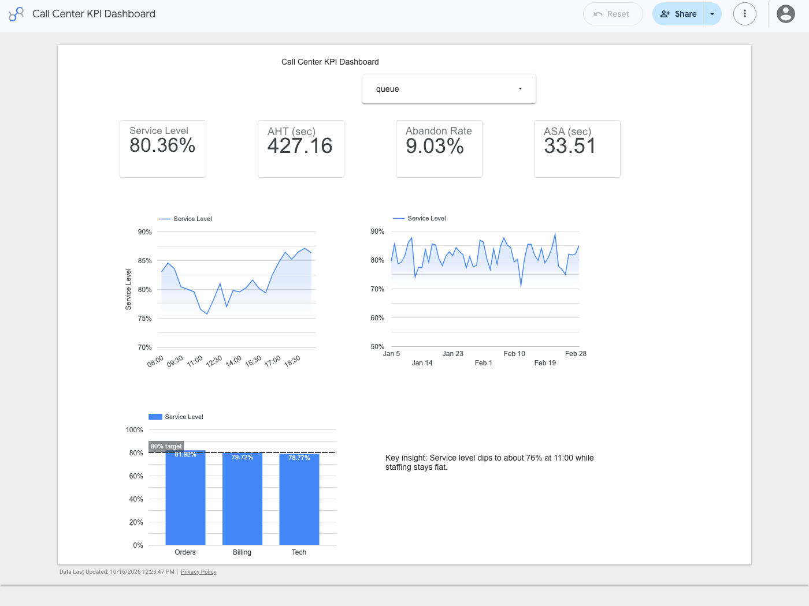

# Looker Studio (Data Studio) build

Live report: [Call Center KPI Dashboard](https://datastudio.google.com/reporting/92f4edea-1216-47ae-82be-718f07dbc80b)

## Data

A Google Sheet loads [`data/intervals.csv`](../data/intervals.csv) straight from this repository with `=IMPORTDATA()`, so the report always reads the same file as the SQL and Python code. `date` is formatted as a date and `interval_start` as `hh:mm`.

## Calculated fields

I defined each KPI once at the data source level, so every chart uses the same logic as [`src/build_kpis.py`](../src/build_kpis.py):

| Field | Formula | Type |
|---|---|---|
| Service Level | `SUM(answered_within_sla) / SUM(offered)` | Percent |
| AHT (sec) | `(SUM(talk_sec) + SUM(hold_sec) + SUM(acw_sec)) / SUM(answered)` | Number |
| Abandon Rate | `SUM(abandoned) / SUM(offered)` | Percent |
| ASA (sec) | `SUM(total_wait_sec) / SUM(answered)` | Number |

The tiles match the Python output: service level 80.36%, AHT 427.16 sec, abandon rate 9.03%, ASA 33.51 sec.

## Visuals

- **KPI scorecards** for the four fields above.
- **Service level by 30-minute interval** (sorted by time, Y-axis from 70%), which shows the dip to 76.5% at 11:00 and 75.7% at 11:30.
- **Service level by queue** with an 80% target reference line: Orders 81.92%, Billing 79.72%, Tech 78.77%.
- **Daily service level trend** over the 8 weeks.
- **Queue drop-down filter.**
- **Key insight:** service level dips to about 76% at 11:00 while staffing stays flat.
